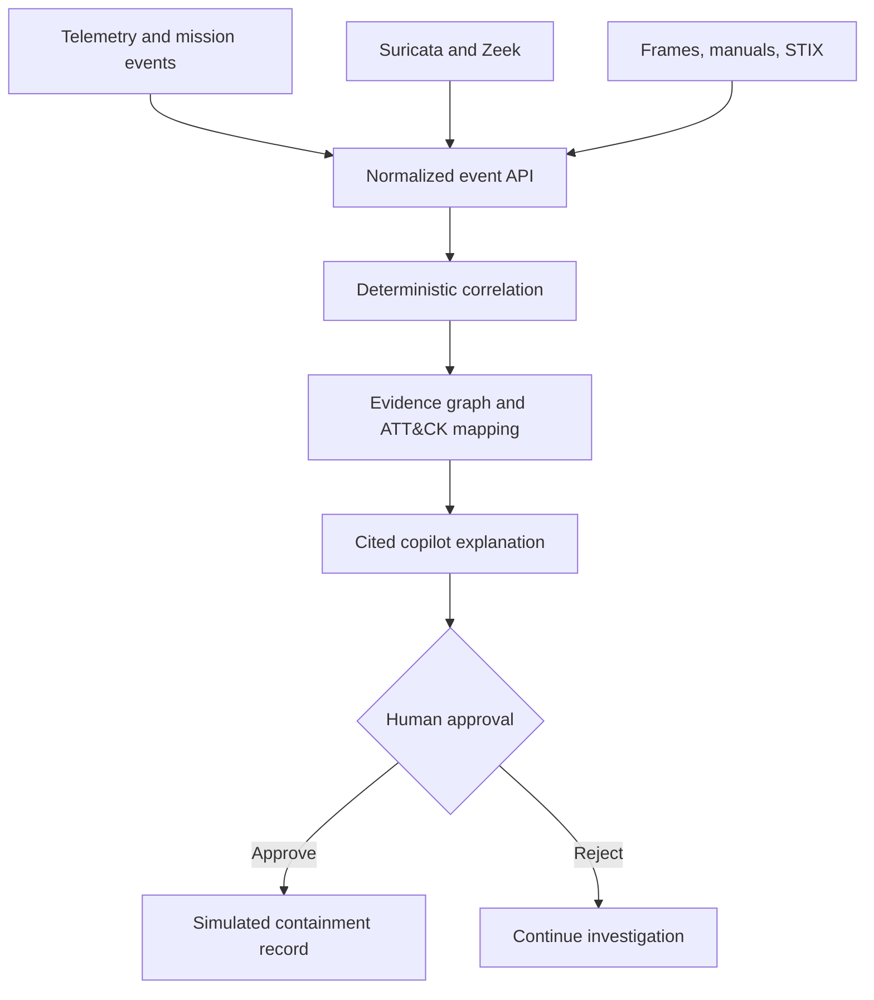

# Multimodal UAV Cybersecurity Copilot

A portfolio-ready research prototype that correlates MAVLink telemetry, Suricata/Zeek events, mission logs, visual observations, equipment guidance, STIX 2.1 threat intelligence, and ATT&CK for ICS mappings. It uses transparent correlation rules, evidence-linked explanations, GraphRAG-style evidence graphs, approval-gated response recommendations, and evaluation metrics.

> This application uses simulated data and simulated attacks. It is not flight software, is not safety-certified, and must not be used to command a real aircraft.

## Run

```bash
docker compose up --build
```

Open <http://localhost:8005>. Choose a scenario and select **Simulate & investigate**. API documentation is at <http://localhost:8005/docs>.

## Test

```bash
python -m venv .venv
source .venv/bin/activate
pip install -r requirements.txt
PYTHONPATH=. pytest -q
```

## Architecture



## Implemented capabilities

- Typed, source-normalized event ingestion.
- Simulated GPS spoofing, command injection, telemetry DoS, visual mismatch, and benign scenarios.
- Cross-source correlation with inspectable rules and confidence scoring.
- Evidence citations and an alert/evidence/technique graph.
- ATT&CK technique mappings for control manipulation, denial of service, blocked reporting, and point/tag identification.
- Human approval endpoint and append-only in-memory audit trail.
- Precision, recall, false-positive rate, MTTD, citation accuracy, investigation-time-saved estimate, and agent task-completion rate.
- Responsive dashboard, REST API, Docker Compose, health check, and automated tests.

## Critical evaluation notes

The dashboard metrics are meaningful only when evaluated across a labeled scenario corpus. The included scenarios prove the evaluation plumbing, not real-world efficacy. `investigation_time_saved_minutes` is explicitly an estimate (12.5 minutes per completed investigation) and should be replaced with measured analyst baselines. Citation accuracy currently measures evidence presence; a production study should have analysts judge whether each cited item truly supports each claim.

## Production extension path

1. Add adapters for pymavlink, EVE JSON, Zeek JSON, object storage, and a frame-embedding service.
2. Store events in Kafka/Redpanda, time-series data in TimescaleDB, objects in S3/MinIO, and relationships in Neo4j.
3. Index manuals and STIX objects with hybrid retrieval plus graph traversal and authorization filters.
4. Add an LLM behind a strict citation schema; keep detection scores deterministic and reject unsupported claims.
5. Create a versioned labeled dataset and replay harness. Report confidence intervals and metrics by attack family, airframe, network condition, and mission phase.
6. Integrate only pre-authorized, reversible response playbooks with two-person approval. Never expose direct flight-control tools to the model.
